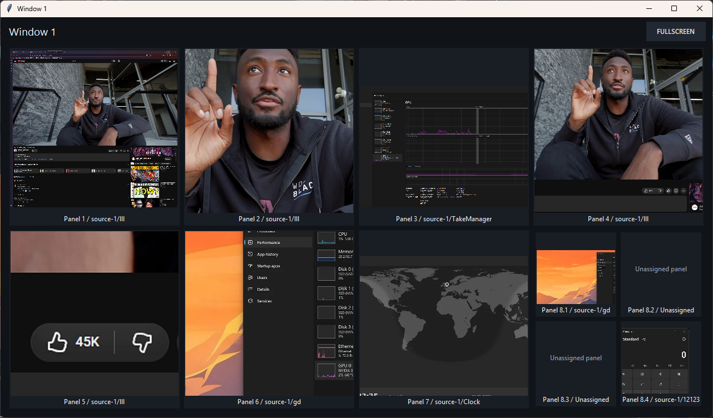

# Kommand

Kommand brings screenshots from multiple machines together in a local
control-room display. **Kommand Source** captures named screen or window
channels and sends them to **Kommand Central**, where you arrange them into a
resizable, fullscreen-capable grid.

[](./_progress/2026-11-25.png)

*Central displaying a multi-channel layout.*

## What it does

- Capture multiple channels on independent schedules, with editable quality and
  full-frame intervals.
- Capture screens on Windows and Linux, and visible application windows on
  Windows, including windows obscured by other applications.
- Choose full WebP frames, WebP change patches, or H.264 video per channel.
- Arrange channels in nested grids and edit layouts while sources are running.
- Display the layout locally on Central, with fullscreen controls and a receive
  bandwidth indicator.
- Edit Source channels during capture without restarting unaffected channels.

Kommand is a work in progress. Linux window capture is not yet supported.
Windows window capture follows the selected window when its title changes; if the
window closes, select it again. Central keeps only the latest frames in memory,
so they disappear when Central restarts.

> **Network and privacy:** Central currently has no built-in authentication or
> TLS and listens on all interfaces by default. Screenshots may contain sensitive
> information. Use an isolated, trusted network or VPN; do not expose Central
> directly to the internet.

## Quick start: Windows

Install [uv](https://docs.astral.sh/uv/getting-started/installation/) first.
From the repository root, run:

```powershell
.\setup_env.cmd
```

The setup script installs Python 3.12 through uv, creates `.venv`, and installs
the dependencies. Run it on the Central machine and on each Source machine.

### 1. Start Central

```powershell
.\run_central.cmd
```

Select **Start server**, then **Open display**. Central listens on port `8000`
by default. The display is a local Tkinter window; use **Fullscreen** or F11 to
toggle fullscreen and Escape to leave it.

[](./_progress/2026-11-25%20-%20Central.png)

### 2. Configure a Source

```powershell
.\run_source.cmd
```

Set the Central URL to `http://127.0.0.1:8000` on the same machine, or
`http://<central-ip>:8000` on another machine. Give each Source a distinct name.
Select **New**, name the channel, choose a screen or window, select **Update**, then
**Save config** and **Start capture**. For screen targets, `0` is the combined
desktop; `1`, `2`, and so on select individual monitors.
The default format is **WEBP + PATCH**. Choose **WEBP** for full frames or
**VIDEO** for H.264, with a separate target frame rate (15 fps by default).
Video carries images only, not audio. Update Source and Central together.

[](./_progress/2026-11-25%20-%20Source.png)

### 3. Arrange the display

Once frames arrive, select a panel in Central, choose a `source/channel`, and
select **Assign**. Adjust the root grid or subdivide panels to build a layout.
In the display, use the mouse wheel to zoom a panel, drag inside it to pan, or
drag outside it to move or swap its assignment. Panel views are saved.
Source channel edits apply when you select **Update** or **Remove**;
connection changes apply on **Save config**.

## Linux

Use Python 3.12 with Tkinter and a graphical display accessible to the capture
process. From the repository root:

```sh
python3.12 -m venv .venv
source .venv/bin/activate
python -m pip install -r requirements.txt
python kommand-central/run.py
# In another terminal, with the virtual environment activated:
python kommand-source/run.py
```

Linux supports screen capture; window capture is not yet enabled.

## Configuration and logs

- Source configuration: `kommand-source/config.json`.
- Latest Source capture per channel: `kommand-source/debug/`. This directory is
  cleared when Source starts.
- Central layout: `kommand-central/layout.json`.
- Central logs: `kommand-central/logs/central.log`, rotated at 5 MiB with five
  backups.
- Source error logs: `kommand-source/logs/source.log`, with the same rotation
  limits.

See the [Source README](./kommand-source/README.md) and
[Central README](./kommand-central/README.md) for capture, transport, and layout
details. The [architecture document](./architecture.md) includes proposed
features as well as the current design.

## Development

The shared application icon lives in `kommand-common/assets/`: `icon.svg` is
the source artwork, `icon.ico` contains Windows icon sizes from 16 to 256 pixels,
and `icon.png` is the desktop fallback on other platforms. Source, Central, and
Central's output windows use it; browser displays use the SVG favicon.
Regenerate the PNG from the SVG before rebuilding the ICO with IconMaker.

Run the test suites from the repository root using the virtual environment:

```powershell
.\.venv\Scripts\python.exe -m unittest discover -s kommand-source\tests
.\.venv\Scripts\python.exe -m unittest discover -s kommand-central\tests
.\.venv\Scripts\python.exe -m unittest discover -s kommand-common\tests
```

Source and Central live in their respective directories; `kommand-common`
contains shared UI components.
Panel titles and the area outside their borders match the window background;
panel interiors retain their separate surface color.
